<p align="center">
  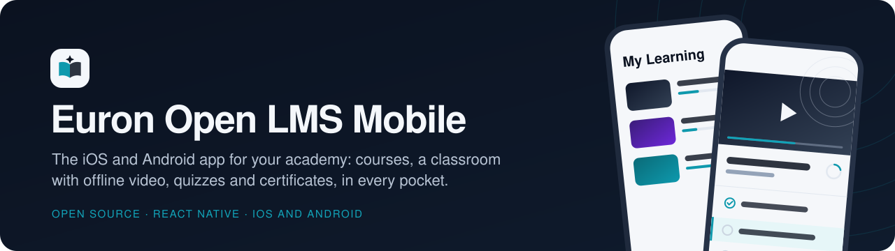
</p>

<p align="center">
  
  <a href="LICENSE"></a>
  
  
  
  
  
  
</p>

<p align="center">
  <a href="https://github.com/euron-sde-team/euron-open-lms-mobile-application/stargazers"></a>
  <a href="https://github.com/euron-sde-team/euron-open-lms-mobile-application/fork"></a>
  <a href="https://github.com/euron-sde-team/euron-open-lms-mobile-application/watchers"></a>
  <br>
  <a href="https://github.com/euron-sde-team/euron-open-lms-mobile-application/issues"></a>
  <a href="https://github.com/euron-sde-team/euron-open-lms-mobile-application/pulls"></a>
  <a href="https://github.com/euron-sde-team/euron-open-lms-mobile-application/commits/main"></a>
  
  <br>
  <a href="#built-by-the-team-behind-euron"></a>
</p>

<p align="center">
  <b><a href="#-quickstart">Quickstart</a></b> ·
  <b><a href="#️-architecture">Architecture</a></b> ·
  <b><a href="#-explore-the-repository">Explore the repo</a></b> ·
  <b><a href="#-payments-per-platform">Payments</a></b> ·
  <b><a href="#-release-your-own-app">Release</a></b> ·
  <b><a href="docs/architecture/security.md">Security</a></b> ·
  <b><a href="#-documentation">Docs</a></b>
</p>

**Euron Open LMS Mobile** is the open-source **iOS and Android learner app** for
[Euron Open LMS](https://github.com/euron-sde-team/euron-open-lms), the self-hosted learning
platform. Learners browse the catalog, buy or enroll, watch lectures (and download them to
watch offline), take quizzes, submit assignments, keep notes and get their certificates, all
in a native app that carries your academy's name. It is MIT-licensed and part of the
open-source initiative of **ENGAGESPHERE TECHNOLOGY PRIVATE LIMITED**.

> [!IMPORTANT]
> **This is the client. The server is [euron-open-lms](https://github.com/euron-sde-team/euron-open-lms).**
> Run it first (`make up && make demo` there): the app talks only to its API. Lecture video
> streams from **[euron-video-system](https://github.com/euron-sde-team/euron-video-system)**
> through the LMS, which mints a short-lived playback session after checking access, so the app
> never holds a video key or talks to the video system's API.

It is built for the realities of a mobile learning app, not as a web view in a wrapper:

- **A real classroom.** A native player with speed, quality and captions, fullscreen, a moving
  watermark and screen-capture protection on paid video; articles, PDFs, quizzes with a server
  timer, assignments with file uploads, notes and lecture Q&A.
- **Offline that stays honest.** Lectures download as encrypted HLS with the key in the
  Keychain or Keystore, play from a tiny loopback server inside the app, and are revalidated
  with the server: a refund or a revoked licence removes the copy.
- **Store-safe payments.** Android buys in the app with Razorpay (or Stripe through the
  academy's site); iOS never shows an in-app purchase, and can link to the website only when an
  admin turns that on.
- **Secure sessions.** A native token mode in the server: the refresh token lives in the
  Keychain or Keystore and rotates on every use, the access token only in memory.
- **The academy's app.** One script gives it your name, bundle id and link scheme; the design
  tokens, fonts and generated course covers match the web app exactly.

<p align="center">
  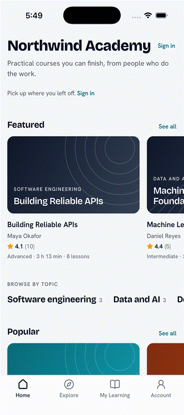
</p>

> [!NOTE]
> Every screen here ran for real: the debug app on an Android emulator and an iPhone simulator
> against a local Euron Open LMS stack (`make up && make demo`), with its stand-ins for
> Razorpay, Stripe, push and the video system. Nothing is mocked in the screenshots.

<h3 align="center">Built by the team behind Euron</h3>

<p align="center">
  <sub>Euron Open LMS Mobile is part of the open-source initiative of ENGAGESPHERE TECHNOLOGY PRIVATE LIMITED, made by the people who build<br>the platforms below. If you like how this repository is built, come and see what we build with it.</sub>
</p>

<p align="center">
  <a href="https://euron.one"><picture><source media="(prefers-color-scheme: dark)" srcset="docs/assets/brand/euron-dark.svg"></picture></a>
  <a href="https://euronsystems.com"><picture><source media="(prefers-color-scheme: dark)" srcset="docs/assets/brand/euron-systems-dark.svg"></picture></a>
  <a href="https://alphaeuron.com"><picture><source media="(prefers-color-scheme: dark)" srcset="docs/assets/brand/alpha-euron-dark.svg">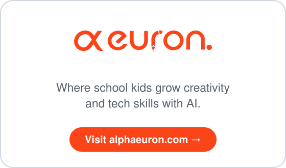</picture></a>
</p>

<p align="center">
  <a href="https://www.instagram.com/euron_official"></a>
  <a href="https://www.linkedin.com/company/euronone/posts/"></a>
  <a href="https://x.com/euron712"></a>
  <a href="https://www.youtube.com/@Euron-official"></a>
  <a href="https://whatsapp.com/channel/0029VaeeJwq9RZAfPW9P2l07"></a>
</p>

---

## 📚 Table of contents

- [The family](#-the-family)
- [At a glance](#-at-a-glance)
- [Screenshots](#️-screenshots)
- [Features](#-features)
- [Architecture](#️-architecture)
  - [Sessions](#sessions)
  - [Playback through the LMS](#playback-through-the-lms)
  - [Offline downloads](#offline-downloads)
- [Payments per platform](#-payments-per-platform)
- [Tech stack](#-tech-stack)
- [Prerequisites](#-prerequisites)
- [Quickstart](#-quickstart)
- [Explore the repository](#-explore-the-repository)
- [Configuration](#️-configuration)
- [Release your own app](#-release-your-own-app)
- [Security model](#-security-model)
- [Testing](#-testing)
- [Documentation](#-documentation)
- [Roadmap](#️-roadmap)
- [FAQ](#-faq)
- [Contributing, security and license](#-contributing-security-and-license)

---

## 🧩 The family

| Repository | What it is | How this app uses it |
|---|---|---|
| [euron-open-lms](https://github.com/euron-sde-team/euron-open-lms) | The LMS: API, web app, admin control plane, Terraform for AWS | **Required.** The app's only server: catalog, learning, assessments, billing, push, download licences |
| [euron-video-system](https://github.com/euron-sde-team/euron-video-system) | Video transcoding and encrypted HLS delivery | Optional, through the LMS: the LMS mints playback sessions, the app streams the HLS it is given |
| **euron-open-lms-mobile-application** | This repository: the iOS and Android learner app | |

## 📊 At a glance

| | |
|---|---|
| **Platforms** | iOS 15.1+ and Android 7+ (API 24), one React Native 0.87 codebase, new architecture, Hermes |
| **Learning** | Catalog with search and filters, course pages, My Learning, a classroom for video, articles and PDFs, notes, lecture Q&A, reviews, certificates with public verification |
| **Assessment** | Quizzes with a server-enforced timer, autosave and review; assignments with rubric feedback, versions and file uploads |
| **Offline** | Encrypted HLS downloads with licence revalidation, played from an in-app loopback server |
| **Commerce** | Android: Razorpay (native SDK) and Stripe (through the academy's site); iOS: no in-app purchase, optional link to the website; orders, invoices, subscriptions |
| **Account** | Profile and photo, password, two-factor sign-in with recovery codes, sessions, notification preferences, data export and account deletion, light and dark mode |
| **Push** | FCM on both platforms through the LMS, off until you add your own Firebase project |
| **Tests** | 261 unit and component tests in 35 suites; 11 Maestro end-to-end flows; contract drift check against the server |
| **License** | MIT |

## 🖼️ Screenshots

<table>
  <tr>
    <td width="33%">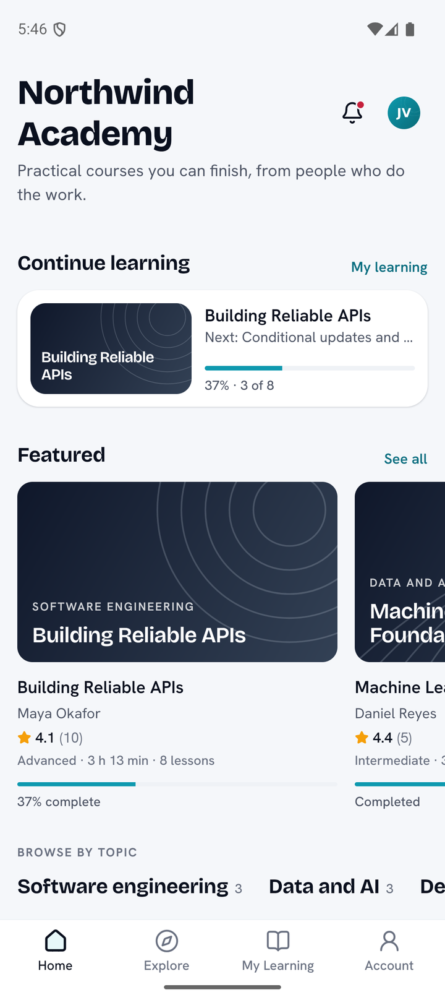<br><sub><b>Home.</b> Continue where you stopped; featured, popular, new and free courses.</sub></td>
    <td width="33%">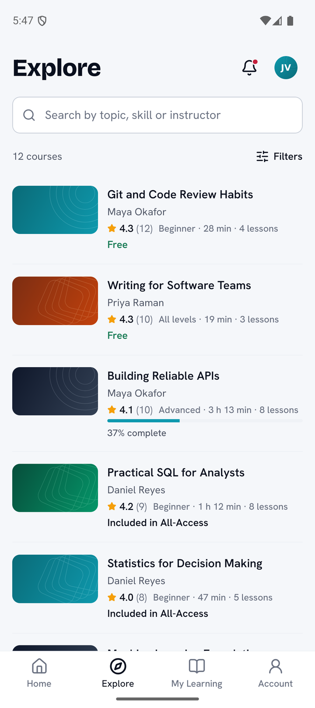<br><sub><b>Explore.</b> Search and filters run on the server, with keyset paging.</sub></td>
    <td width="33%">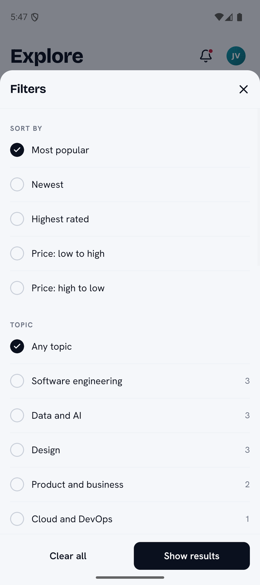<br><sub><b>Filters.</b> Sort, topic, level, language, price, rating and length, with live counts.</sub></td>
  </tr>
  <tr>
    <td>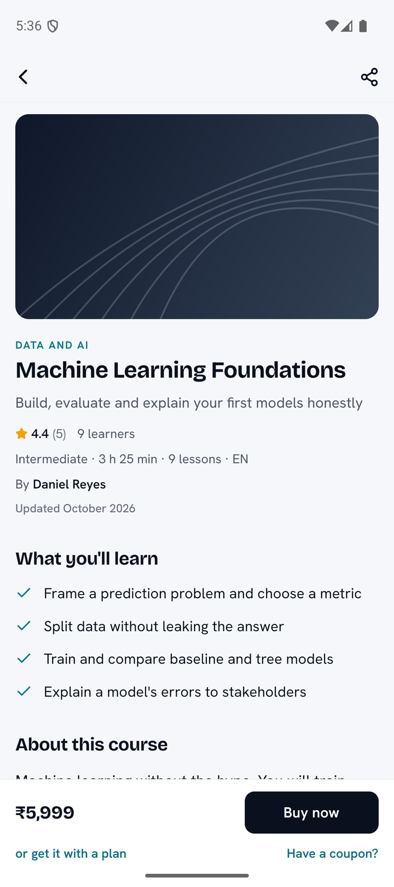<br><sub><b>Course page.</b> Priced by the server in the learner's currency; Buy now on Android.</sub></td>
    <td>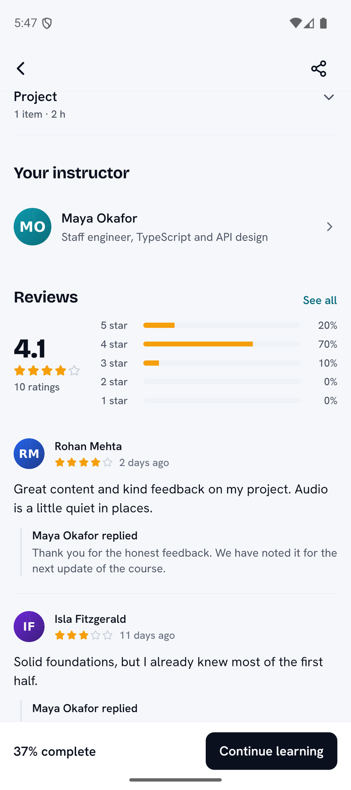<br><sub><b>Reviews.</b> Rating breakdown, instructor replies, write and report reviews.</sub></td>
    <td>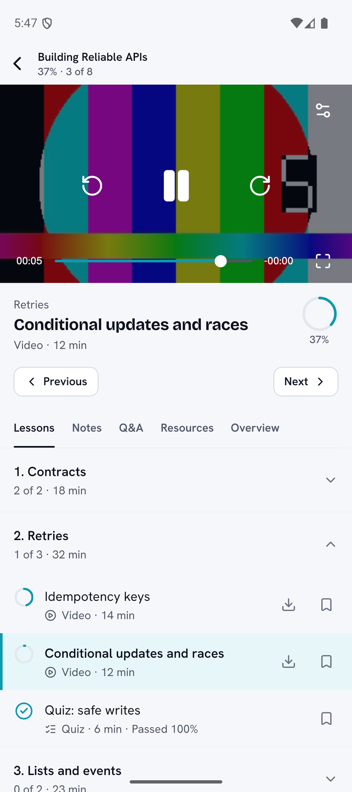<br><sub><b>Classroom.</b> Native player, progress rings, downloads and bookmarks per lesson.</sub></td>
  </tr>
  <tr>
    <td>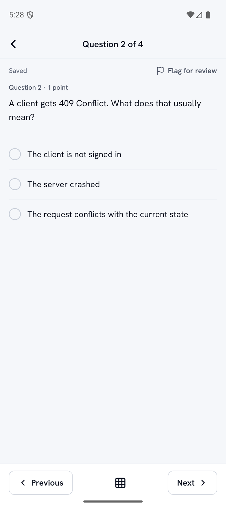<br><sub><b>Quiz.</b> One question at a time, autosaved, flagged for review, timed by the server.</sub></td>
    <td>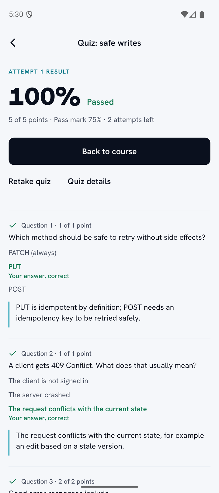<br><sub><b>Results.</b> Score, pass mark and the answer review when the reveal policy allows.</sub></td>
    <td>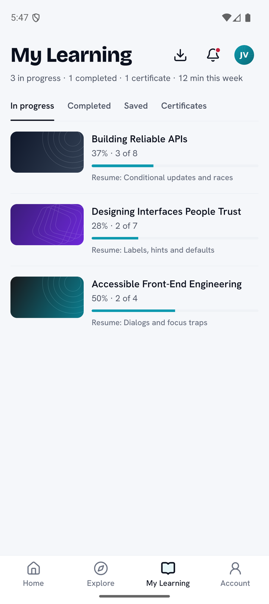<br><sub><b>My Learning.</b> In progress, completed, saved lessons and certificates.</sub></td>
  </tr>
  <tr>
    <td>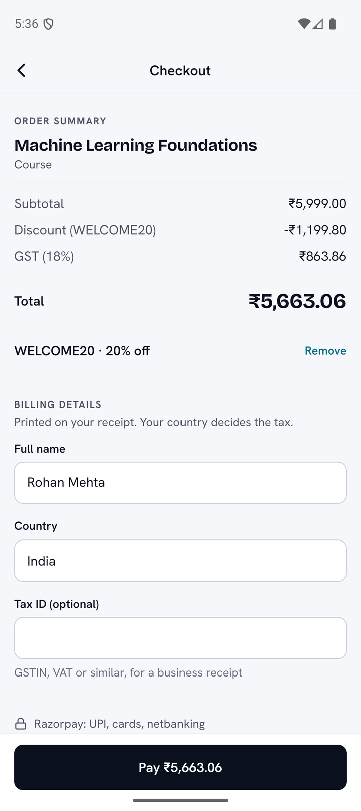<br><sub><b>Checkout (Android).</b> Coupon and tax quoted by the server, paid through Razorpay.</sub></td>
    <td>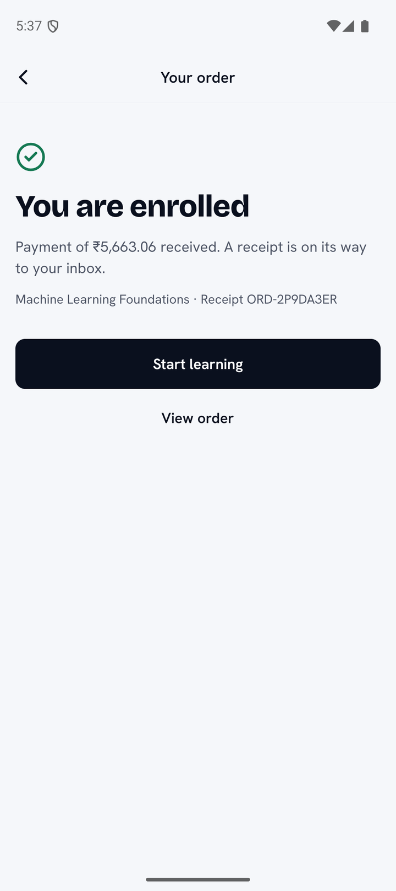<br><sub><b>Enrolled.</b> Confirmed by polling the order until the payment is fulfilled.</sub></td>
    <td>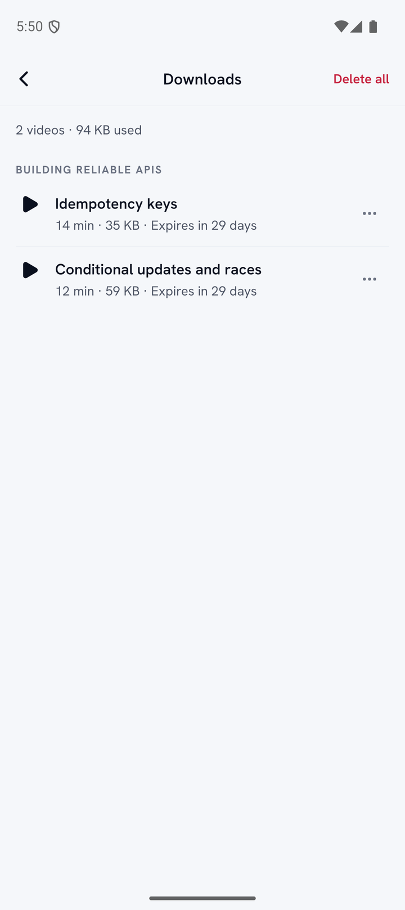<br><sub><b>Downloads.</b> Encrypted copies with their size and licence window.</sub></td>
  </tr>
  <tr>
    <td>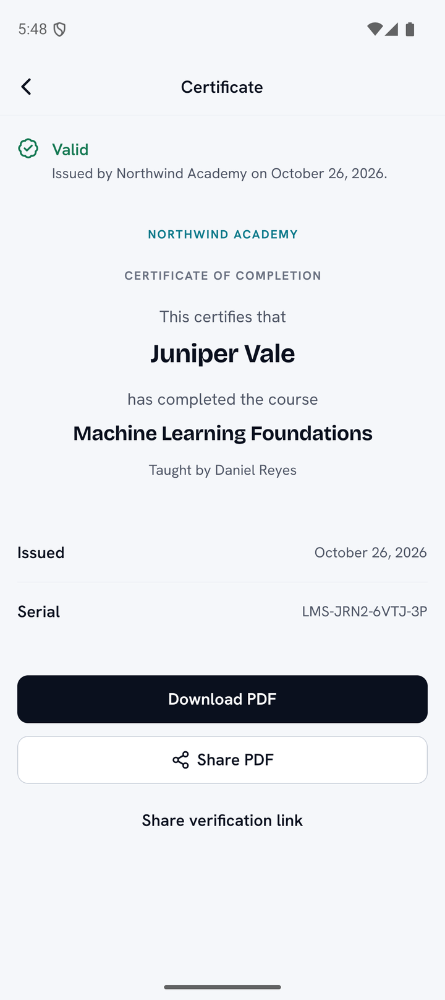<br><sub><b>Certificate.</b> Public verification, PDF in the app, share the file or the verify link.</sub></td>
    <td>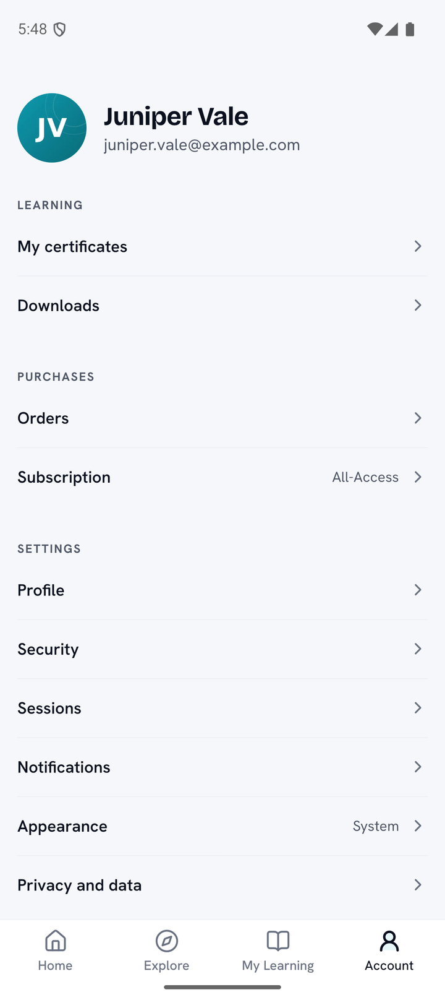<br><sub><b>Account.</b> Orders, subscription, security, sessions, notifications, privacy.</sub></td>
    <td>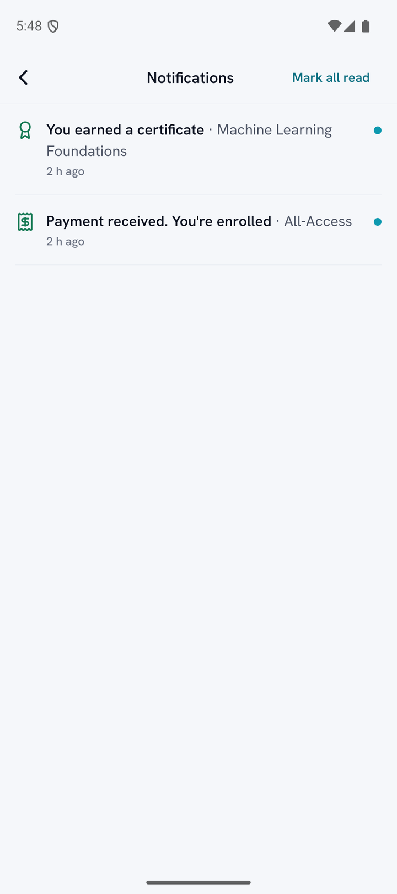<br><sub><b>Notifications.</b> Every row opens the right screen; push does the same.</sub></td>
  </tr>
  <tr>
    <td>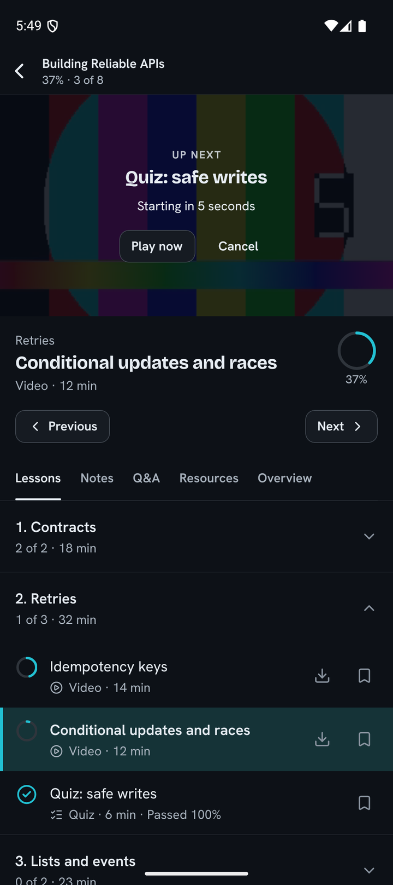<br><sub><b>Dark mode.</b> Every screen, following the system or your choice.</sub></td>
    <td><br><sub><b>iOS.</b> The same app on iPhone; no prices or purchase actions, per App Store rules.</sub></td>
    <td>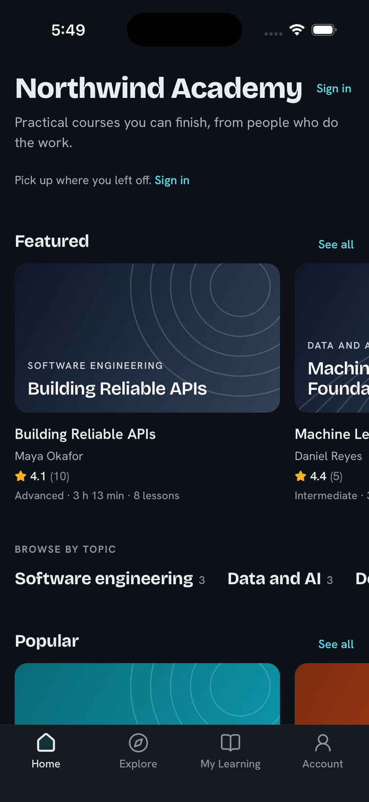<br><sub><b>iOS, dark.</b> System dark mode on iPhone.</sub></td>
  </tr>
</table>

## ✨ Features

| Area | What you get |
|---|---|
| **Catalog** | Home with continue learning and carousels, topics, Explore with debounced search, filters in a sheet (sort, topic, level, language, price, rating, length) with server counts, course and bundle pages, plans, instructors, reviews |
| **Classroom** | Video, article (sanitised HTML rendered natively), PDF and resources; curriculum with progress rings; previous, next and autoplay with a countdown; notes on the timeline; lecture Q&A; free previews for guests |
| **Player** | react-native-video with custom controls: seek, 10 second skips, speed, quality, captions, fullscreen with orientation lock, a drifting watermark, resume, heartbeats, session refresh on expiry; YouTube lessons |
| **Assessments** | Quiz intro, runner and results; the countdown comes from the server's clock; assignments with instructions, rubric, versions, grader feedback and native file uploads straight to storage |
| **Certificates** | List, public verification (valid or revoked), PDF viewer, share |
| **Offline** | One HLS rendition up to 720p, AES key in the Keychain or Keystore, resumable segments, licences revalidated on start, foreground and reconnect, expired copies refuse to play |
| **Checkout** | Android only: server quote with coupons and tax, Razorpay native SDK, Stripe through the academy's https return page, order polling; iOS: never a purchase, optional website link |
| **Account** | Profile with photo upload, password change, TOTP two-factor with recovery codes, sessions, per-category email and push preferences, appearance, data export, account deletion, about |
| **Notifications** | Inbox with unread state, push registration after the first sign-in, a foreground banner, taps that open the right screen |
| **Platform** | Deep links (`openlms://` and optional universal or App Links), guest browsing with modal sign-in, offline start into Downloads, light and dark themes, accessibility labels and 44 point targets |

## 🏗️ Architecture

<p align="center">
  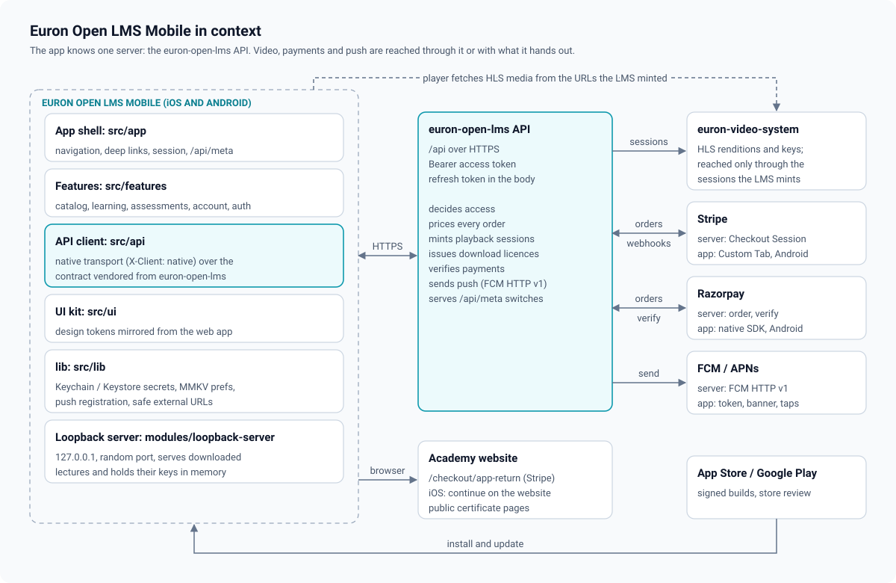
</p>

- **One server.** Everything goes through the Euron Open LMS API. The app has no payment
  secrets, no video keys and no admin powers; the server decides access, prices and licences.
- **The contract is vendored, not guessed.** `src/api/vendor` is copied from the server's
  shared types and endpoint groups by `pnpm sync-types`, with a CI check that fails on drift.
- **Server state in TanStack Query**, client state in small providers; keys in one place
  (`src/app/query.ts`).
- **Feature folders** (`src/features/{catalog,learning,assessments,account}`) on a small design
  system (`src/ui`) whose tokens mirror the web app's, so a course looks the same everywhere.

### Sessions

<p align="center">
  
</p>

The server's native token mode returns the refresh token in the response body instead of a
cookie. The app keeps it in the Keychain or Keystore (readable after the first unlock, this
device only), keeps the access token in memory, and refreshes on a stale-token 401 through a
single-flight call, so the rotating token is never used twice. Details in
[docs/architecture/sessions-and-native-tokens.md](docs/architecture/sessions-and-native-tokens.md).

### Playback through the LMS

<p align="center">
  
</p>

The app asks the LMS to play a lesson; the LMS checks access and returns a short-lived HLS
session from euron-video-system (or an HLS or MP4 URL, or a YouTube id). The app never builds
a video URL. Heartbeats carry the current playhead and the played seconds; the server keeps
the furthest point and caps watched time. See [docs/architecture/video-playback.md](docs/architecture/video-playback.md).

### Offline downloads

<p align="center">
  
</p>

A download starts with a licence from the server (`POST /api/learn/items/:id/downloads`),
which checks access, the academy's switch and the course's setting. The app saves one
rendition and its AES key (in the Keychain or Keystore, never on disk), then plays the copy
through `modules/loopback-server`: a small Swift and Kotlin server bound to `127.0.0.1` on a
random port, behind a per-session token, serving only the downloads folder. Licences are
revalidated whenever the app starts, returns to the foreground or reconnects. Details in
[docs/architecture/offline-downloads.md](docs/architecture/offline-downloads.md).

## 💳 Payments per platform

<p align="center">
  
</p>

| | Android | iOS |
|---|---|---|
| Course, bundle and plan prices | Shown | Not shown |
| Buy in the app | Yes: server quote, then Razorpay's native SDK, or Stripe opened in a Custom Tab and returned through the academy's `https://…/checkout/app-return` page | Never |
| Link to the website | Not needed | Only when the admin turns on **Mobile app → iOS web purchase link** in the LMS settings |
| Access bought elsewhere | Works | Works: sign in and learn |
| Manage a subscription | Cancel, resume, change plan | Cancel and resume only |

The rule lives in one pure function, [`purchaseMode`](src/app/meta.tsx), and every screen
asks it; the tests check every state on both platforms. The reasoning (App Store guideline
3.1.1, reader-style access) is in [docs/architecture/payments.md](docs/architecture/payments.md).

## 🧰 Tech stack

| Layer | Choice |
|---|---|
| App | React Native 0.87 (bare CLI, new architecture, Hermes), React 19, TypeScript strict |
| Navigation | React Navigation 7 (native stack, bottom tabs), typed routes, deep linking |
| Data | TanStack Query 5, a vendored typed client from euron-open-lms, fetch with a native token transport |
| Storage | react-native-keychain (secrets), MMKV (preferences and the downloads index) |
| Media | react-native-video, react-native-youtube-iframe, react-native-pdf, react-native-blob-util, a native loopback module (Swift Network.framework, Kotlin) |
| Payments | react-native-razorpay (Android), react-native-inappbrowser-reborn (Stripe return), react-native-webview (local stand-in) |
| Push | React Native Firebase messaging (FCM, APNs through FCM) |
| UI | A small design system with the web app's tokens, Bricolage Grotesque and Hanken Grotesk (OFL), lucide icons, react-native-render-html, react-native-svg |
| Quality | Jest, React Native Testing Library, Maestro, ESLint, gitleaks, a sanitisation scan |

## 📋 Prerequisites

- A running [euron-open-lms](https://github.com/euron-sde-team/euron-open-lms) stack (Docker; `make up && make demo`)
- Node.js 22 and pnpm 9
- iOS: macOS with Xcode 26 or later, CocoaPods (Ruby bundler)
- Android: Android Studio with SDK 36, JDK 17, an emulator or a device

No Apple or Google developer account, no payment account and no Firebase project are needed to
run it locally.

## 🚀 Quickstart

```bash
# 1. The server (in a sibling folder)
git clone https://github.com/euron-sde-team/euron-open-lms.git
cd euron-open-lms && make up && make demo && cd ..

# 2. The app
git clone https://github.com/euron-sde-team/euron-open-lms-mobile-application.git
cd euron-open-lms-mobile-application
cp .env.example .env          # points at http://localhost:5026/api
pnpm install
pnpm pods                     # iOS only
pnpm start                    # Metro, in its own terminal

pnpm ios                      # iPhone simulator
pnpm android:reverse && pnpm android   # Android emulator or USB device
```

Sign in with the demo accounts that `make demo` prints (one shared password):

| Account | Try |
|---|---|
| `juniper.vale@example.com` | A learner with the all-access plan: continue learning, the classroom, a quiz, a certificate, downloads |
| `rohan.mehta@example.com` | A learner in India: on Android, buy a course in rupees through the Razorpay stand-in with the coupon `WELCOME20` |

The iOS simulator reaches your Mac's `localhost` directly; `pnpm android:reverse` forwards the
stack's ports into the emulator. On a physical phone over Wi-Fi, put your Mac's LAN address in
`.env`. The full walkthrough is in [docs/guides/quickstart.md](docs/guides/quickstart.md).

## 🧭 Explore the repository

```
App.tsx                     providers: safe area, theme, server state, session, navigation
src/
  app/                      routes, navigator, tab bar, deep links, session (native tokens),
                            /api/meta flags and the purchase rule, query client and keys
  api/                      the native transport (http.ts) and the client (client.ts)
    vendor/                 the contract copied from euron-open-lms (pnpm sync-types)
  features/
    catalog/                home, explore and filters, course, bundle, plans, instructor, reviews
    learning/               My Learning, classroom, player, notes and Q&A, downloads engine
    assessments/            quiz runner and results, assignments with uploads, certificates
    account/                account, profile, security, sessions, notifications, orders,
                            subscription, checkout (Android), push
  ui/                       design tokens, theme, components (text, buttons, layout, inputs,
                            HTML, media with generated covers)
  lib/                      Keychain, MMKV preferences, URL safety, push
modules/loopback-server/    the native loopback server for offline playback (Swift, Kotlin)
ios/  android/              the native projects (committed; bare React Native CLI)
scripts/                    sync-types, rename-app, android-reverse, sanitisation scan
e2e/flows/                  Maestro flows against a local euron-open-lms stack
docs/                       architecture, ADRs, guides
```

Start at [docs/guides/walkthrough.md](docs/guides/walkthrough.md): it follows a learner from
install to a certificate, naming the file at every step.

## ⚙️ Configuration

Only what the app needs before it can reach the server is set at build time, in `.env`
([`.env.example`](.env.example)):

| Key | What |
|---|---|
| `API_BASE_URL` | The euron-open-lms API, including `/api` |
| `WEB_BASE_URL` | The academy's website (certificate links, the iOS website link, the Stripe return page) |
| `APP_SCHEME` | The deep link scheme (`openlms` by default; `scripts/rename-app.sh` changes it everywhere) |
| `APP_LINK_HOST` | Optional: the academy's domain for universal links and Android App Links |
| `CAPTURE_GUARD` | Debug builds only: `off` allows screenshots of paid video for QA and docs |

Everything else comes from the server at run time through `GET /api/meta`: the academy's name,
currencies and gateways, and the **Mobile app** switches admins set in the LMS
(`iosWebPurchaseLink`, `downloadsEnabled`, `pushEnabled`, `minSupportedVersion`). See
[docs/guides/configuration.md](docs/guides/configuration.md).

## 📦 Release your own app

```bash
scripts/rename-app.sh --id org.northwind.academy --name "Northwind Academy" --scheme northwind
```

Then add your icons, set your Apple team in Xcode, put your Android keystore in
`android/keystore.properties` (never committed), and, for push, your Firebase project's
`google-services.json` and `GoogleService-Info.plist`. Release builds sign only from those
files; without them the release build is unsigned. Store notes, versioning and review tips are
in [docs/guides/release.md](docs/guides/release.md) and [docs/guides/push.md](docs/guides/push.md).

## 🔐 Security model

- **Secrets:** the refresh token and the offline video keys live only in the Keychain or
  Keystore (after first unlock, this device only); the access token only in memory; nothing
  sensitive in MMKV, logs or WebViews.
- **Transport:** HTTPS only in release. Android allows plain HTTP to `127.0.0.1` (the loopback
  server) and, in debug builds only, to the local stack; iOS allows local networking only.
- **Access:** the server decides everything; the app never builds a video URL, never sees a
  gateway secret, and treats every link it opens through one validator.
- **Paid video:** screen capture protection (Android FLAG_SECURE, an iOS capture overlay), a
  watermark, and offline licences that expire and are revoked on refund.
- **The repository:** no keys, Firebase files or signing material are committed; a sanitisation
  scan and gitleaks run in CI.

Details and the limits we know about are in [docs/architecture/security.md](docs/architecture/security.md)
and the [threat model](docs/architecture/threat-model.md). To report a vulnerability, see
[SECURITY.md](SECURITY.md).

## 🧪 Testing

| Suite | What it proves | Run |
|---|---|---|
| Unit and component (261 in 35 suites) | The native transport and single-flight refresh, deep links, the purchase rule on both platforms, heartbeats, capture protection, HLS parsing and rewriting, the download state machine and revalidation, quiz clock and autosave, uploads, checkout handoffs and order polling, push guards, and render tests for every main screen | `pnpm test` |
| Contract | The vendored API types and endpoints match euron-open-lms | `pnpm sync-types:check` |
| End to end (Maestro, 11 flows) | Guest browsing, sign-in, the classroom, a quiz, an assignment, a certificate, an Android purchase through the Razorpay stand-in, no checkout on iOS, offline playback, notes and Q&A, sessions and sign-out | `pnpm e2e:ios` / `pnpm e2e:android` |
| Hygiene | ESLint with zero warnings, TypeScript strict, the sanitisation scan, gitleaks | `pnpm lint typecheck sanitize` |

How to run each suite against a local stack is in [docs/guides/testing.md](docs/guides/testing.md).

## 📖 Documentation

| Architecture | Guides |
|---|---|
| [High-level design](docs/architecture/HLD.md) | [Quickstart](docs/guides/quickstart.md) |
| [App architecture](docs/architecture/app-architecture.md) | [iOS](docs/guides/ios.md) and [Android](docs/guides/android.md) |
| [Sessions and native tokens](docs/architecture/sessions-and-native-tokens.md) | [Configuration](docs/guides/configuration.md) |
| [Video playback](docs/architecture/video-playback.md) | [Video with euron-video-system](docs/guides/video-with-euron-video-system.md) |
| [Offline downloads](docs/architecture/offline-downloads.md) | [Push notifications](docs/guides/push.md) |
| [Payments](docs/architecture/payments.md) | [Payments](docs/guides/payments.md) |
| [Push](docs/architecture/push.md) | [Release and signing](docs/guides/release.md) |
| [Security](docs/architecture/security.md) and [threat model](docs/architecture/threat-model.md) | [Testing](docs/guides/testing.md) |
| [Decision records](docs/architecture/adr/README.md) | [Troubleshooting](docs/guides/troubleshooting.md) |
| | [Walkthrough: a learner, end to end](docs/guides/walkthrough.md) |

## 🗺️ Roadmap

- In-app purchase on iOS and Google Play Billing, as an option next to the gateways
- Captions and resources in offline downloads
- Tablet layouts with the curriculum beside the player
- Picture in picture and background audio for lectures
- Live classes from the LMS when it adds them
- More languages for the app's own text

Ideas and pull requests are welcome: open an issue to discuss larger changes first.

## ❓ FAQ

<details>
<summary><b>Do I need euron-open-lms?</b></summary>

Yes. This app is the learner client of Euron Open LMS and has no backend of its own. Run the
LMS locally with `make up && make demo`, or deploy it to AWS with its Terraform, and point
`API_BASE_URL` at it.
</details>

<details>
<summary><b>Where does the video come from?</b></summary>

From [euron-video-system](https://github.com/euron-sde-team/euron-video-system), through the
LMS: you upload and transcode there, connect it to the LMS, and pick videos on lessons. The
app asks the LMS to play a lesson and streams the short-lived session it gets back. HLS or MP4
URLs and YouTube work too.
</details>

<details>
<summary><b>Why can't learners buy on iOS?</b></summary>

Apple requires its own in-app purchase for digital content sold inside an iOS app. This app
does not sell on iOS: learners who bought on the website (or on Android) sign in and learn. An
admin can turn on a plain link to the website where the rules allow it. Store billing is on the
roadmap as an option.
</details>

<details>
<summary><b>Can learners watch offline, and is it safe?</b></summary>

Yes, when the academy allows it and the course does. Downloads are encrypted HLS; the key never
touches the disk, playback goes through a loopback server only the app can reach, and the copy
expires unless the server renews its licence. A refund or an admin revoke deletes it on the next
check.
</details>

<details>
<summary><b>Do I need Firebase?</b></summary>

Only for push. Without the Firebase files the app builds and runs with push off; everything
else works. With them, set `PUSH_PROVIDER=fcm` on the LMS.
</details>

<details>
<summary><b>Expo?</b></summary>

No: a bare React Native CLI project with committed native folders, because the app ships its
own native module (the loopback server) and needs control over linking and signing. The
reasoning is in [ADR 0001](docs/architecture/adr/0001-bare-react-native-cli.md).
</details>

<details>
<summary><b>Is the demo data real?</b></summary>

No. Every person, course and order comes from the LMS demo seed: fictional people, reserved
example domains, and covers generated by code.
</details>

## 🤝 Contributing, security and license

- Contributions: read [CONTRIBUTING.md](CONTRIBUTING.md) and the
  [code of conduct](CODE_OF_CONDUCT.md). API changes start in euron-open-lms, then
  `pnpm sync-types` here.
- Security issues: please report privately, as described in [SECURITY.md](SECURITY.md).
- License: [MIT](LICENSE). The bundled fonts are under the SIL Open Font License
  ([src/assets/fonts/OFL.txt](src/assets/fonts/OFL.txt)).

Released under the [MIT License](LICENSE). Copyright (c) 2026 ENGAGESPHERE TECHNOLOGY
PRIVATE LIMITED and the Euron Open LMS Mobile contributors.

<p align="center">
  <sub>If Euron Open LMS Mobile is useful to you, <a href="https://github.com/euron-sde-team/euron-open-lms-mobile-application/stargazers">star the repository</a>: it helps others find it.</sub>
</p>
