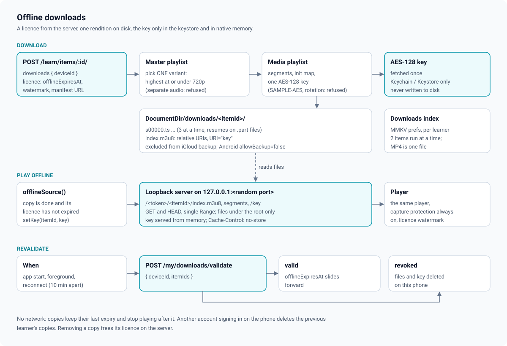

# Offline downloads

A learner can save a video lecture and watch it without a network. A saved video is a
**licence** the server issued for this device, not a free file: it plays only inside its
licence window, it is revalidated whenever the app is online, and the server can take it
back. Server side:
[ADR 0022 in euron-open-lms](https://github.com/euron-sde-team/euron-open-lms/blob/main/docs/architecture/adr/0022-offline-downloads-inside-a-playback-session.md).
App side: [ADR 0005](adr/0005-offline-downloads-with-a-loopback-server.md).



Code: [`downloads/engine.ts`](../../src/features/learning/downloads/engine.ts),
[`downloads/hls.ts`](../../src/features/learning/downloads/hls.ts),
[`downloads/state.ts`](../../src/features/learning/downloads/state.ts),
[`downloads/loopback.ts`](../../src/features/learning/downloads/loopback.ts),
[`downloads/useDownloads.ts`](../../src/features/learning/downloads/useDownloads.ts),
[`modules/loopback-server/`](../../modules/loopback-server/),
[`screens/DownloadsScreen.tsx`](../../src/features/learning/screens/DownloadsScreen.tsx).

## 1. When the download button shows

`downloadsOffered()` requires every switch:

| Switch | Source |
| --- | --- |
| The academy allows downloads | `mobile.downloadsEnabled` in `/api/meta` (the admin setting `learning.offline.enabled`) |
| The course allows downloads | `classroom.course.allowDownloads` |
| The native loopback module is linked | `NativeModules.OpenLmsLoopback` |
| The learner is signed in | session status |
| The viewer is not on a preview | `classroom.role !== "PREVIEW"` |

The server re-checks everything when the licence is requested, so the button is a
convenience, not the control.

## 2. Taking a licence

`POST /api/learn/items/:itemId/downloads { deviceId }`. The `deviceId` is a random
installation id the app makes once and keeps in MMKV (`PREF.deviceId`); it is never a
hardware identifier. The server runs the same access check as playback, refuses a free
preview, a YouTube or unready video, and a learner over the academy's
`learning.offline.maxPerUser`, and answers an `OfflineDownload`: the stream (an EVS session
minted with the longest ttl EVS grants, or the HLS/MP4 URL), `offlineExpiresAt`, the
watermark, the course and title. Refusals arrive as stable codes and become one line of
copy (`downloadErrorMessage()` in [`state.ts`](../../src/features/learning/downloads/state.ts)):
`OFFLINE_DISABLED`, `DOWNLOADS_NOT_ALLOWED`, `DOWNLOAD_LIMIT_REACHED`, `VIDEO_NOT_READY`,
`COURSE_ACCESS_REQUIRED` and so on.

## 3. Fetching the stream

The engine fetches everything inside that playback session:

**HLS (EVS or plain HLS)**

1. Fetch the master playlist and keep **one** variant
   ([`pickVariant()`](../../src/features/learning/downloads/hls.ts)): the highest whose
   height is at most 720; when the playlist gives no heights, the highest bandwidth at or
   under 2.5 Mbps, else the lowest. A variant with a separate audio group is refused
   (`UNSUPPORTED_STREAM`).
2. Fetch its media playlist and parse segments, the fMP4 init map and the key. Only
   `AES-128` with a single key is supported; `SAMPLE-AES`, DRM methods and rotating keys
   are refused.
3. Fetch the AES-128 key once and write it, base64, **to the Keychain only**
   (`open-lms.download.<itemId>`, `AFTER_FIRST_UNLOCK_THIS_DEVICE_ONLY`). The key never
   touches the file system.
4. Download every segment with three parallel transfers into
   `DocumentDir/downloads/<itemId>/` (`s00000.ts`, `init.mp4`, ...), each to a `.part` file
   renamed on completion. Segments already on disk are skipped, so a pause, a crash or a
   dropped connection resumes where it stopped. Byte-range playlists list one file many
   times; it is downloaded once.
5. Write a local `index.m3u8`: the same tags, every URI made relative to the folder, the key
   URI rewritten to `"key"`, and `#EXT-X-ENDLIST` added if missing.

**MP4**: the file is downloaded to `video.mp4` with progress.

At most two items download at a time; the rest queue. The item folder is excluded from
iCloud backup on iOS (`excludeFromBackupKey`); on Android the app sets
`android:allowBackup="false"`.

## 4. States

[`state.ts`](../../src/features/learning/downloads/state.ts) is the pure state machine,
persisted in MMKV (`PREF.downloads`) with one entry per lecture, stamped with the learner's
user id:

```
queued -> downloading -> done
                      -> failed     (a refusal or an unsupported stream; "Try again" requeues)
                      -> paused     (by the learner, or automatically when the network drops)
done + past offlineExpiresAt = expired (does not play until a revalidation extends it)
```

An entry left `downloading` when the app was killed comes back `queued`. A download paused
because the connection dropped (`autoResume`) continues by itself when the phone is back
online.

## 5. Playing offline: the loopback server

`react-native-video` needs a URL for HLS, and the AES key must not be a file. The native
module [`open-lms-loopback`](../../modules/loopback-server/) is a minimal HTTP/1.1 server,
written twice with the same rules: Swift on Network.framework
([`LoopbackHTTPServer.swift`](../../modules/loopback-server/ios/LoopbackHTTPServer.swift)) and
plain JVM Kotlin ([`LoopbackHttpServer.kt`](../../modules/loopback-server/android/src/main/java/org/openlms/loopback/LoopbackHttpServer.kt)).

| Rule | Detail |
| --- | --- |
| Address | `127.0.0.1` on a random port. The iOS server also drops any connection whose peer is not loopback |
| Token path | Every request path starts with `/<token>/`, 32 random hex characters made at start (compared in constant time), so another app on the phone that finds the port still cannot read anything |
| Methods | `GET` and `HEAD` only (`405` otherwise) |
| Ranges | One `Range: bytes=` range: `206` with `Content-Range`, `416` when unsatisfiable |
| Root confinement | Path segments may contain only letters, digits, `.`, `-`, `_`, never `.` or `..`; the resolved path must stay inside the downloads root; only regular files. Anything else is `404` |
| Key route | `/<token>/<itemId>/key` answers the key handed over with `setKey()`, from memory only, `Cache-Control: no-store` |
| Connections | One request per connection (`Connection: close`); files stream in chunks |

To play a saved HLS copy, `offlineSource()` checks the entry is `done` and inside its window,
starts the server once per root (same port and token while it runs), reads the key from the
Keychain and hands it to the server, and returns
`http://127.0.0.1:<port>/<token>/<itemId>/index.m3u8`. An MP4 copy plays from its
`file://` path. The Downloads screen plays it in a full-screen player with capture
protection always on and the watermark from the licence.

The server and its keys live as long as the app process. When the module is not linked,
`isLoopbackAvailable()` is false and the download buttons are hidden.

## 6. Revalidation, expiry and revocation

`POST /api/my/downloads/validate { deviceId, itemIds }` for every entry that holds a
licence:

- **When:** after sign-in (the lifecycle hook attaches the engine to the learner and
  revalidates), when the app returns to the foreground (at most every 10 minutes), and when
  the connection comes back (forced).
- **Valid** licences get their new `offlineExpiresAt`: a learner online regularly keeps a
  copy for as long as their access lasts.
- **Revoked** items (access ended or refunded, downloads switched off for the academy or the
  course, the item changed, support revoked it, never licensed on this device) are deleted
  at once: running transfer cancelled, folder removed, Keychain key removed, entry removed.
- **Offline**, nothing changes: copies keep their last expiry and stop playing when it
  passes (the academy's `learning.offline.days`, 30 by default).

Deleting a copy in the app deletes the files and key and tells the server
(`DELETE /api/my/downloads/:itemId`) so the licence slot is free again.

## 7. Accounts and sign out

- Signing out stops running transfers. Files stay on the phone and keep their licence
  window, so the learner who signs back in finds them.
- When a **different** account signs in on the same phone, every copy stamped with another
  user id is deleted with its key before anything else runs.
- Starting offline with a stored session, the engine attaches to the last signed-in user
  (`PREF.lastUser`) so that user's copies play.

## 8. Android network security

Release builds allow cleartext HTTP only to `127.0.0.1`
([`src/main/res/xml/network_security_config.xml`](../../android/app/src/main/res/xml/network_security_config.xml)):
the loopback server and nothing else. Debug builds override it
([`src/debug/res/xml/network_security_config.xml`](../../android/app/src/debug/res/xml/network_security_config.xml))
to reach a local euron-open-lms stack over `http`. iOS allows the loopback server through
`NSAllowsLocalNetworking` with `NSAllowsArbitraryLoads` false.

## 9. Limitations

- **Not DRM.** Segments are stored as the stream delivered them (AES-128 encrypted for an
  encrypted EVS stream), with the key in the Keychain. A rooted or jailbroken device can
  extract the key and the segments; the watermark is the deterrent, as online.
- **MP4 and unencrypted HLS copies are plain files** in the app's sandbox (excluded from
  backup). The sandbox is the only protection.
- **One rendition, at most 720p**; separate audio groups, `SAMPLE-AES`, DRM and key rotation
  are not supported and fail with "This video's format cannot be saved for offline viewing."
- **No background transfer session.** Transfers are ordinary requests, not registered with
  the OS as background downloads, so the OS may suspend them once the app leaves the
  foreground. A transfer that fails that way pauses itself and continues from the segments
  already on disk.
- **The device clock** decides expiry offline. Moving the clock back extends playback until
  the next online check, which then applies the server's answer.
- **Keys stay in loopback memory** until the app process ends (`stopLoopback()` exists but is
  not called on sign-out).
