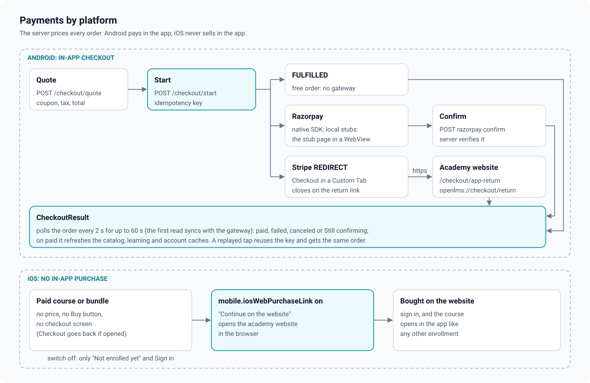

# Payments

What a learner can buy in the app depends on the platform, and the app never prices
anything: the server quotes every line, discount, tax and total, and fulfils an order only
after the gateway confirms the amount. Server side:
[payments.md in euron-open-lms](https://github.com/euron-sde-team/euron-open-lms/blob/main/docs/architecture/payments.md).
Decision: [ADR 0004](adr/0004-no-in-app-purchase-on-ios-razorpay-on-android.md).

Code: [`app/meta.tsx`](../../src/app/meta.tsx) (`purchaseMode`),
[`catalog/purchase.ts`](../../src/features/catalog/purchase.ts),
[`catalog/components/PurchaseBar.tsx`](../../src/features/catalog/components/PurchaseBar.tsx),
[`account/CheckoutScreen.tsx`](../../src/features/account/CheckoutScreen.tsx),
[`account/lib/checkout.ts`](../../src/features/account/lib/checkout.ts),
[`account/CheckoutResultScreen.tsx`](../../src/features/account/CheckoutResultScreen.tsx),
[`account/lib/billing.ts`](../../src/features/account/lib/billing.ts).

## 1. Per-platform rules

`purchaseMode(meta)` returns one of three modes, and every purchase surface (course page,
bundle page, plans, the Home plan teaser) renders from it through pure functions in
[`purchase.ts`](../../src/features/catalog/purchase.ts), each combination unit tested:

| Mode | Platform | The learner sees |
| --- | --- | --- |
| `in-app` | Android | Prices, "Buy now", "Buy bundle", "Subscribe" / "Start free trial", coupons, the checkout screen |
| `web-link` | iOS, when the admin turned on `mobile.iosWebPurchaseLink` | No price and no buy button; a note "Available on <academy>'s website" and an outline button "Continue on the website" that opens the academy's course, bundle or plans page in the system browser |
| `none` | iOS, by default | No price, no purchase wording, nothing to tap; "Not enrolled yet" and, for guests, "Sign in" |

On every platform the learner keeps what they own: an enrolled, plan-included or staff
course shows "Start learning" / "Continue learning", and free courses show "Enroll for free".
On iOS, someone who bought on the website signs in to learn ("Already enrolled? Sign in").
The `Checkout` route goes back immediately if it is ever opened on iOS.

### Why iOS sells nothing in the app

App Store Review Guideline 3.1.1 requires In-App Purchase to unlock digital content and
features inside an app, and forbids buttons or links that steer buyers to other purchasing
methods except where a storefront rule or entitlement allows it. Euron Open LMS sells
through Stripe and Razorpay with a server price book, invoices and refunds that In-App
Purchase would not share. So the iOS app works as a reader of content bought elsewhere
(guideline 3.1.3), shows no prices, and links out only when the academy's operator has
decided that their storefront and entitlements allow it, by switching on
`mobile.iosWebPurchaseLink` in the admin settings. The switch defaults to off. Operators
should check the current guidelines for their storefront before turning it on; this
repository does not give legal advice. Android allows third-party billing for these
purchases, so checkout runs in the app.

## 2. Android checkout

The `Checkout` screen takes `{ type: COURSE | BUNDLE | PLAN, id, coupon?, interval? }`.

1. **Currency.** The account's preferred currency when the academy sells in it, else the
   academy default. There is no picker.
2. **Quote.** `POST /api/checkout/quote` with the item, currency, coupon and billing
   details (name, country, optional tax id; debounced 400 ms). The summary shows the lines,
   subtotal, discount, the tax line (for example "GST (18%)" or "VAT (20%, included)", the
   rate read back from the amounts), the total and, for plans, the recurring note ("Free for
   14 days, then ..."). A plan with both periods shows Monthly / Yearly tabs.
3. **Coupons.** "Have a coupon?" opens a field (codes are upper-cased, spaces removed); the
   quote reports the coupon or a `couponError`, shown as plain copy (`NOT_FOUND`,
   `EXPIRED`, `EXHAUSTED`, `CURRENCY_MISMATCH`, `ALREADY_USED`, ...). A coupon typed on the
   course page is carried into checkout.
4. **Problems** that block a purchase (`ALREADY_OWNED`, `SUBSCRIPTION_EXISTS`,
   `PAYMENT_NOT_CONFIGURED`, `NOT_FOR_SALE`, `CHECKOUT_IN_PROGRESS`, ...) replace the pay
   button with a notice and a way forward (My Learning, the subscription, orders, back).
5. **Start.** `POST /api/checkout/start` with the same body plus an idempotency key, and for
   Stripe a `returnUrl`. The app never sends an amount.

### Idempotency keys

A Pay tap reuses the key stored for the same request, so a retried tap or a return after the
app was killed gets the same order back instead of a second one. The key is stored in MMKV
per item (`checkout.key:<type>:<id>:<interval>`) with a fingerprint of everything the
server prices from (item, interval, currency, coupon, billing name, country and tax id). A
changed request gets a fresh key. A key whose order has closed (`CHECKOUT_CLOSED`,
`CHECKOUT_EXPIRED`) is replaced once. The key is cleared when the purchase reaches the result
screen.

### Handoffs

[`runHandoff()`](../../src/features/account/lib/checkout.ts) takes its native pieces as
dependencies, so every route is unit tested:

| Handoff | What the app does |
| --- | --- |
| `FULFILLED` | Nothing to pay (zero total, or a retried start of a paid order): straight to the result |
| Razorpay, `mode: native` | Opens the Razorpay SDK (`react-native-razorpay`) with the order or subscription id, amount, currency, academy name, prefill and the brand colour. Success posts `{ razorpay_payment_id, razorpay_order_id or razorpay_subscription_id, razorpay_signature }` to `POST /api/checkout/razorpay/confirm` |
| Razorpay, `mode: stub` | Against a local stack (the server's `RAZORPAY_CHECKOUT_SCRIPT_URL` points at the stubs): the stub's `checkoutPageUrl` opens in a WebView sheet, with `redirect=<scheme>://checkout/razorpay`. The WebView intercepts that link, reads the signed fields and posts the same confirm |
| `REDIRECT` (Stripe) | Opens Stripe's hosted Checkout in a Custom Tab (`InAppBrowser.openAuth`) that closes on `<scheme>://checkout/return` |

The Razorpay SDK is linked on Android only
([`react-native.config.js`](../../react-native.config.js)) and loaded with `require()` at the
moment of payment, because importing it on iOS would crash the app.

Closing the Razorpay sheet, or a Custom Tab, is not an error: the screen says "Payment not
completed. You were not charged." and keeps the quote. A Razorpay failure shows its reason.
A Custom Tab closed by hand after paying is caught by asking the server once
(`GET /api/checkout/orders/:id?sync=1`).

### Stripe return through the website

Stripe documents an https `success_url` for apps, so the `returnUrl` is the academy's own
page: `<WEB_BASE_URL>/checkout/app-return?app=<APP_SCHEME>`. Stripe returns there with
`orderId` (or `canceled=1`); the web page checks `app` against the server's
`MOBILE_RETURN_SCHEMES` (sent as `mobile.appReturnSchemes`) and opens
`<scheme>://checkout/return?orderId=<id>`, which closes the Custom Tab and opens
`CheckoutResult`. A scheme that is not allowed gets no redirect, so the page is never an open
redirect. An app renamed to another scheme needs that scheme in `MOBILE_RETURN_SCHEMES`
([release guide](../guides/release.md)).

## 3. The result screen

[`CheckoutResultScreen`](../../src/features/account/CheckoutResultScreen.tsx) polls
`GET /api/checkout/orders/:id` every 2 s for up to a minute; the first read asks the server
to sync with the gateway once (`sync=1`). The webhook usually fulfils the order first.

| Phase | Shown |
| --- | --- |
| pending | "Confirming your payment" |
| paid | "You are enrolled" / "Your plan is active" / "Your free trial has started", the amount, the receipt number, "Start learning" (to the order's `continueTo`, else the course) and "View order". The catalog, learning, orders, subscription and certificate caches and `me` are refreshed so access shows everywhere |
| failed | "The payment did not go through" with the reason and "Try again" |
| canceled | "Checkout canceled", nothing charged. Arriving with `canceled=1` from Stripe cancels the still-pending order |
| timeout (still pending after a minute) | "Still confirming", "Refresh" and "See your orders" |

## 4. Tax, receipts and orders

Tax is computed by the server from the billing country (the screen guesses it from a
single-country currency or the device region; the learner can change it). The receipt comes
by email, and Orders lists every order with its invoice PDF, opened in the in-app PDF viewer
and shareable. A subscription can be canceled at period end and resumed from the
Subscription screen on both platforms (managing an existing plan is not a purchase);
changing or buying a plan is offered only on Android.
