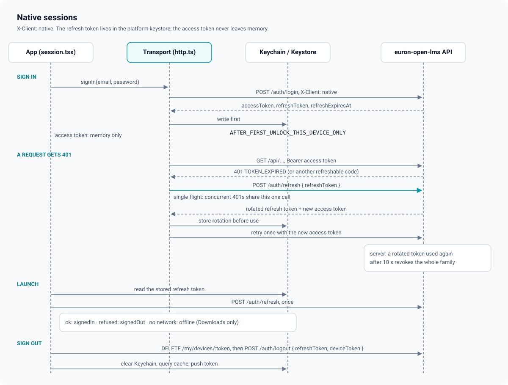

# Sessions and native tokens

The app uses the same session model as the web app (short access tokens, one rotating
refresh token per sign-in, family revocation on reuse) in **native token mode**: the
refresh token travels in request and response bodies instead of a cookie, and the app keeps
it in the platform keystore. The server side is
[ADR 0020 in euron-open-lms](https://github.com/euron-sde-team/euron-open-lms/blob/main/docs/architecture/adr/0020-native-token-mode.md);
this page is the app side ([ADR 0003](adr/0003-native-token-mode-and-keychain.md)).

Code: [`src/api/http.ts`](../../src/api/http.ts) (transport),
[`src/app/session.tsx`](../../src/app/session.tsx) (provider),
[`src/lib/secure-store.ts`](../../src/lib/secure-store.ts) (keystore),
[`src/features/account/lib/signout.ts`](../../src/features/account/lib/signout.ts).

## 1. Where each token lives

| Secret | Where | Lifetime |
| --- | --- | --- |
| Access token | A React ref inside `SessionProvider`, memory only | Until it expires or the process ends |
| Refresh token, its expiry and the user id | Keychain (iOS) or Keystore-backed storage (Android) through `react-native-keychain`, service `open-lms.session`, accessibility `AFTER_FIRST_UNLOCK_THIS_DEVICE_ONLY` | Until rotation, sign-out or expiry |
| Nothing else | MMKV holds only non-secret prefs ([`storage.ts`](../../src/lib/storage.ts)) | |

`AFTER_FIRST_UNLOCK_THIS_DEVICE_ONLY` means the token is readable once the phone has been
unlocked after a reboot (so a refresh can run while the app resumes in the background), is
never synced to iCloud Keychain, and is not restored to another device from a backup.

## 2. Native mode on the wire

Every request from [`HttpClient`](../../src/api/http.ts) carries:

| Header | Value |
| --- | --- |
| `X-Client` | `native` |
| `X-App-Version` | `<version> (<build>)` from `react-native-device-info` |
| `Authorization` | `Bearer <access token>` when signed in |

Requests use `credentials: "omit"`; the app never relies on a cookie jar. Every endpoint that
issues a session (sign-up without verification, verify-email, sign-in including the
two-step code, refresh) answers the usual `AuthResult` plus `refreshToken` and
`refreshExpiresAt`. If a sign-in answer lacks them the app refuses it with "The server did
not return a native session. Update euron-open-lms." instead of half signing in.

## 3. Sign in and sign up

- `signIn()` posts the login. A `totpRequired` answer switches the screen to the two-step
  code (or a recovery code); a native session is stored and `status` becomes `signedIn`.
- `signUp()` either signs in at once or, when the academy requires verification, returns
  `verificationRequired` and the app shows "Check your email". Opening the verification
  link (`/verify-email?token=`) in the app completes it with `adopt()`.
- Storing a session (`persist`) writes the Keychain entry first, then the in-memory refs,
  then remembers the user id in MMKV (`PREF.lastUser`, used by offline downloads).

## 4. Refresh: single flight, write before use

The refresh token rotates on every use, and the server treats a second use of an old token
(after a ten-second grace) as theft: it revokes the whole family and audits
`session.reuse_detected`. So the app must never send two refreshes with the same token.

- `HttpClient.refreshSession()` keeps one in-flight promise. Concurrent `401`s from parallel
  queries all wait on the same `POST /auth/refresh { refreshToken }`.
- A request is retried after a refresh only when the `401` carries a refreshable code
  (`TOKEN_INVALID`, `TOKEN_EXPIRED`, `SESSION_EXPIRED`), or `UNAUTHENTICATED` while a token
  was sent. Auth endpoints themselves opt out (`noRefresh`).
- `onRefresh` (the provider's `persist`) is awaited **before** the new access token is used,
  so a crash right after a rotation cannot leave a spent token in the Keychain.
- A refresh answered `401` or `403` means the session is over: the provider signs out
  locally (`SESSION_EXPIRED`). A network error during refresh is rethrown and never signs
  anyone out; the request fails and the screen offers a retry.

## 5. Launch

On start the provider reads the Keychain:

| Stored session | Result |
| --- | --- |
| None | `signedOut` (guest) |
| Present but `refreshExpiresAt` passed | Cleared, `signedOut` |
| Present, refresh succeeds | `signedIn` with the fresh `me` |
| Present, refresh rejected | Cleared locally, `signedOut` |
| Present, server unreachable | `offline`: the stored session is kept and the app opens on Downloads ([`OfflineScreen.tsx`](../../src/app/OfflineScreen.tsx)) |

The offline screen listens to NetInfo and calls `retry()` when a connection returns, which
runs the launch refresh again. Offline playback of saved lectures needs no token at all
([offline downloads](offline-downloads.md)).

## 6. Sign out

[`signOutDevice()`](../../src/features/account/lib/signout.ts), from the Account tab or the
Sessions screen:

1. **This device only:** `DELETE /api/my/devices/<push token>` while the session still
   works, so pushes stop for this phone.
2. `POST /api/auth/logout { refreshToken, deviceToken }` (or `POST /api/auth/logout-all`
   for "Sign out everywhere", which on the server also deletes every push device of the
   account). Failures are ignored: signing out must always work locally, offline or with a
   revoked session.
3. Locally: the access and refresh refs are cleared, the Keychain entry is deleted, the
   whole TanStack Query cache is cleared, `me` becomes null and `status` becomes
   `signedOut`.
4. The push token is forgotten (`deleteToken`) so the next person on this phone gets a
   fresh one.

Downloaded lectures stay on the phone after sign-out (the Account tab says so) and keep
their licence window; they are deleted when a **different** account signs in on the same
phone, or when the learner deletes them ([offline downloads](offline-downloads.md)).

The Sessions screen lists every session of the account (this one first) and can sign out
any other one (`GET /api/users/me/sessions`, `DELETE /api/users/me/sessions/:id`,
removed from the list optimistically).

## 7. What never leaves the API client

- Tokens are never written to MMKV, never logged (there is no `console` logging in `src/`),
  and never passed to a WebView, a Custom Tab or a share sheet.
- The only in-app WebViews are the Razorpay stub page during local development (incognito,
  no shared cookies, only `http(s)` and the app's own return link may load) and the YouTube
  iframe player. Neither receives a token.
- Stripe Checkout opens in a Custom Tab, a separate browser context.
- Files that need authorisation are fetched through the API first: the certificate PDF's
  short-lived signed URL comes from an authenticated `verify` call and is downloaded with
  `react-native-blob-util`, so no web view ever holds a session.
- Links inside server HTML open in the system browser through `safeExternalUrl()`
  (only `http` and `https`).
