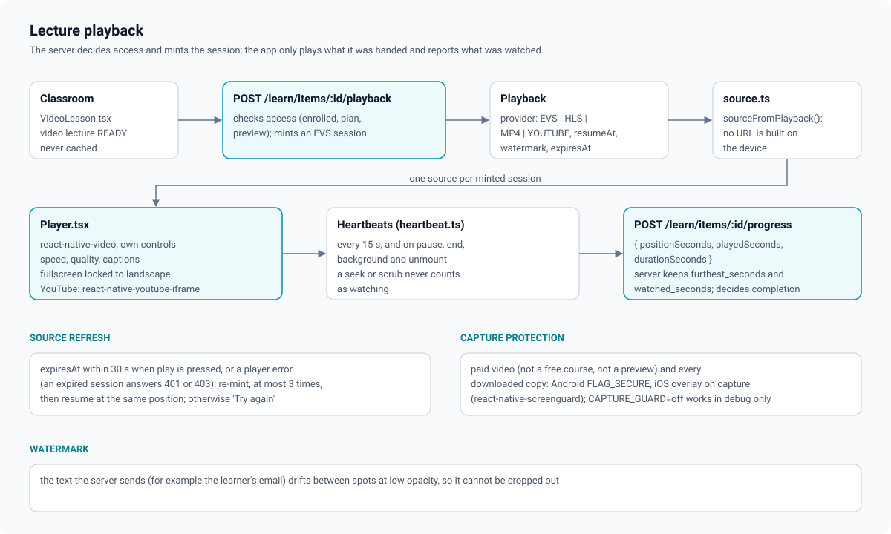

# Video playback

Lecture video belongs to euron-video-system (EVS), and access belongs to euron-open-lms.
The app talks to neither EVS nor a storage bucket directly: it asks the LMS for playback,
and the LMS checks access and answers with something playable. Server side:
[video.md in euron-open-lms](https://github.com/euron-sde-team/euron-open-lms/blob/main/docs/architecture/video.md)
and [progress-and-certificates.md](https://github.com/euron-sde-team/euron-open-lms/blob/main/docs/architecture/progress-and-certificates.md).

Code: [`classroom/VideoLesson.tsx`](../../src/features/learning/classroom/VideoLesson.tsx),
[`player/Player.tsx`](../../src/features/learning/player/Player.tsx),
[`player/source.ts`](../../src/features/learning/player/source.ts),
[`player/heartbeat.ts`](../../src/features/learning/player/heartbeat.ts),
[`player/protect.ts`](../../src/features/learning/player/protect.ts),
[`player/Watermark.tsx`](../../src/features/learning/player/Watermark.tsx).

## 1. Getting something to play

1. The classroom opens a video lecture whose `videoStatus` is `READY` (otherwise it shows
   "This video is still processing" or "could not be processed").
2. `VideoLesson` calls `POST /api/learn/items/:itemId/playback`. The server runs its access
   check for this viewer; for an EVS lecture it mints a short-lived EVS playback session
   bound to the viewer. The query is never cached (`staleTime: Infinity`, `gcTime: 0`,
   no retry): a session is single use.
3. [`sourceFromPlayback()`](../../src/features/learning/player/source.ts) turns the answer
   into a player source. URLs are never assembled on the client:

| `provider` | Plays with | Notes |
| --- | --- | --- |
| `EVS` | `react-native-video` (HLS, `manifestUrl`) | Carries `expiresAt`, a poster and the watermark text |
| `HLS` | `react-native-video` (HLS `url`) | |
| `MP4` | `react-native-video` (`url`) | |
| `YOUTUBE` | `react-native-youtube-iframe` | The id is read from the server's `embedUrl`; YouTube draws its own controls |

An answer the app cannot map shows "This video cannot play in the app. Open the lesson on
the website instead."

## 2. The player

`react-native-video` 6 with the app's own controls (never the native ones): tap to show or
hide them (they hide after 3 s while playing), play/pause, 10 s back and forward, a scrubber
with the buffered track, elapsed and remaining time, a settings sheet (speed 0.75x to 2x,
quality by the heights the stream reports, captions when the stream has text tracks,
"Autoplay the next lesson", and the download row when downloads are offered), fullscreen
locked to landscape with the status bar hidden (Android Back leaves fullscreen), a poster
until the first frame, a buffering spinner and an error state with "Try again".

The resume point is the server's `resumeAt` (or the item's saved position), honoured only
when it is past the first 5 s and before the last 10 s. At the end of a lesson an "Up
next" panel counts down 5 s to the next item when autoplay is on (a per-device switch).

## 3. Heartbeats

[`heartbeat.ts`](../../src/features/learning/player/heartbeat.ts) is a pure accumulator,
unit tested. While playing it sends `POST /api/learn/items/:itemId/progress` with a
`ProgressBeat`:

| Field | Meaning |
| --- | --- |
| `positionSeconds` | The current playhead: where the learner resumes next time |
| `playedSeconds` | Real playback since the last beat, whole seconds (the fraction carries over) |
| `durationSeconds` | The stream's duration when known |

- A beat goes out every 15 s while playing, and on pause, end, the app going to the
  background, and unmount. Requests use `keepalive`.
- `playedSeconds` counts a step forward only when the wall clock and the playback rate
  allow it (1.5x slack plus 0.35 s), so a seek or a scrub never counts as watching. Seeks,
  source reloads and pauses mark a discontinuity.
- Nothing is sent before anything played, and an empty beat at the same position is
  skipped, so opening and closing a lesson cannot wipe the resume point.
- Rewinding cannot lose progress: the server keeps its own furthest mark and computes
  completion from watched time (the academy's `videoCompletePercent`), never from the
  position the app sends.
- Only learners send beats (`role === "LEARNER"`). A beat answered with `STAFF_PREVIEW`,
  `PREVIEW`, `COURSE_ACCESS_REQUIRED`, `ENROLLMENT_NOT_ACTIVE` or `NOT_A_VIDEO` stops
  beats for that item.
- The server's `ProgressResult` updates the curriculum's progress in the query cache.

YouTube lessons sample the iframe's clock once a second and send the same beats.

Downloaded copies played offline send no heartbeats.

## 4. Expiry and refresh

An EVS source carries `expiresAt`. The player re-requests playback through `onRefresh`
(a fresh `POST .../playback`) when:

- play is pressed within 30 s of `expiresAt`, or
- the player reports an error (an expired session answers `401`/`403` to the segment or
  key request).

It keeps the current position, swaps the source and resumes there. After three refreshes
in a row without a successful load it shows "The video stopped loading." with "Try again".

## 5. Screen capture protection

[`protect.ts`](../../src/features/learning/player/protect.ts) decides, as a pure function:

| Playing | Protected |
| --- | --- |
| A downloaded copy | Always |
| A free preview lesson | No |
| A lesson of a `FREE` course | No |
| Any other lesson (including while the course's access mode is still loading) | Yes |

While protection is held, `react-native-screenguard` turns on Android's `FLAG_SECURE`
(screenshots and recordings of the app are black, and the app is blanked in the recent
apps view) and the library's capture overlay on iOS. Holders are counted, so nested
players do not switch it off early. YouTube lessons play in YouTube's iframe player and are
not capture protected (the YouTube component does not take the `protect` prop).

`CAPTURE_GUARD=off` in `.env` disables protection **in debug builds only**, for QA and
documentation screenshots. Release builds ignore it (`config.captureGuard` is
`!(__DEV__ && CAPTURE_GUARD === "off")`).

Capture protection is a deterrent, not DRM: an external camera, or a rooted or jailbroken
device, can still record. The watermark is the second deterrent: the text the server sends
(normally the learner's email), drawn at low opacity and drifting slowly between random
spots every 9 s so it cannot be cropped out. See [security.md](security.md).
